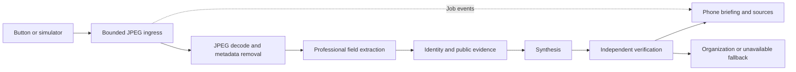

# Architecture

Single-process modular monolith: `domain.py` contains validated contracts; `ports.py` defines the provider boundary; `providers.py` implements Meta/mock adapters; `pipeline.py` owns memory jobs/cache/events; `quality.py` and `safety.py` implement deterministic checks; `app.py` provides HTTP/session/device/SSE interfaces.

Input safety checks validate JPEG decoding, size and dimensions. Blur, darkness and glare produce advisory warnings but do not block extraction. The model reads professional fields directly; if the organization is unreadable, the user can correct it before research. Metadata is removed before inference. Image bytes are not attached to jobs, events or disk. Python memory release does not guarantee allocator/OS erasure.

States follow the brief plus `AWAITING_CONFIRMATION` and `CANCELLED`. Corrections cancel/await previous work; job budget persists across revisions. Forget marks the job deleted, cancels/awaits work, clears fields/results/cache, removes deduplication and wakes SSE readers. Expiry uses the original capture time. Research cache uses salted SHA-256 normalized identity keys and a 30-minute TTL.

Sessions last 8 hours, pairing codes 5 minutes. The device registry persists only IDs and token hashes. Raw launcher credentials stay in an ignored local file. No history database is enabled. The ledger is process-local and resets on restart.

Sources must be nonlocal HTTPS URLs outside blocked domains. The host never fetches pages: it consumes provider-returned snippets. Source assessment and semantic verification remain probabilistic; the independent verifier is another call to the same model, not independent ground truth.

The UI is buildless browser JavaScript rather than Preact/Vite. This is an intentional simplification for a small LAN tool: one origin, no frontend dependencies, no CDN, native text rendering, responsive CSS, PWA shell and SSE. Only static assets are cached. Accessibility is considered but not certified.

**One Uvicorn worker only.** A broker is unnecessary for one device. Multiple workers/users require durable queue/store coordination and a shared budget ledger. The provider is abstracted; memory store/event bus stay simple in-process implementations for v1.

Locally enforced bounds: bytes, pixels, job concurrency, retries, deadlines and request reservations. No documented provider-side hard search-query ceiling was verified. Search is disabled until explicitly enabled; account billing controls remain necessary.
